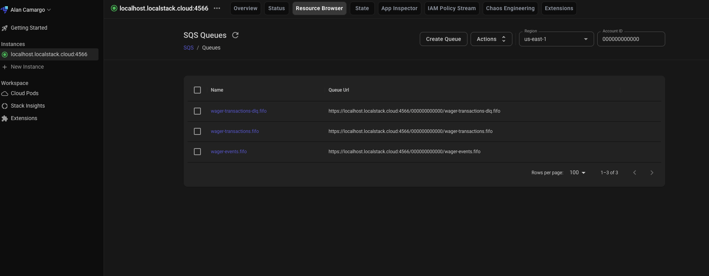
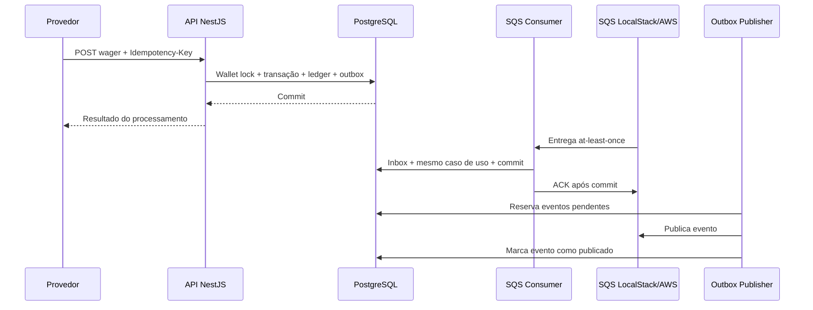

# Distributed Wagering Processor

API financeira para processar operações de apostas com valores exatos, ledger auditável, idempotência persistente e processamento assíncrono com PostgreSQL e SQS.

## Pré-requisitos

- Bun 1.x
- Docker com Docker Compose
- Git

## Iniciar o projeto localmente

1. Clone o repositório e entre na pasta do projeto.
2. Se ainda não tiver um `.env`, crie-o a partir do exemplo:

   ```bash
   test -f .env || cp .env.example .env
   ```

   Os valores do exemplo atendem ao ambiente local. Se sua distribuição do LocalStack exigir autenticação, informe seu token em `LOCALSTACK_AUTH_TOKEN` no `.env`.

3. Instale as dependências:

   ```bash
   bun install
   ```

4. Suba PostgreSQL, LocalStack e a inicialização das filas:

   ```bash
   docker compose up -d
   ```

   O serviço `sqs-init` cria as filas FIFO `wager-transactions.fifo`, `wager-transactions-dlq.fifo` e `wager-events.fifo`. Confira os serviços e as filas:

   ```bash
   docker compose ps -a
   docker compose exec localstack awslocal sqs list-queues
   ```

   O endpoint local da API AWS é `http://localhost:4566`. A imagem abaixo registra as filas criadas no LocalStack:

   

5. Aplique as migrations do banco:

   ```bash
   bun run migration:up
   ```

6. Inicie a API em modo de desenvolvimento:

   ```bash
   bun run start:dev
   ```

7. Acesse o Swagger em [http://localhost:3000/docs](http://localhost:3000/docs). A especificação OpenAPI fica em [http://localhost:3000/docs-json](http://localhost:3000/docs-json).

   

8. Confira liveness, readiness e métricas:

   ```bash
   curl http://localhost:3000/health/live
   curl http://localhost:3000/health/ready
   curl http://localhost:3000/metrics
   ```

   `/health/ready` verifica PostgreSQL e SQS. `/metrics` exporta métricas no formato Prometheus.

Para encerrar a aplicação, pare o processo iniciado no terminal. Para parar os containers sem apagar os dados persistidos:

```bash
docker compose down
```

## Exemplo rápido de uso da API

Crie uma wallet e use o `id` retornado na próxima requisição:

```bash
curl --request POST http://localhost:3000/wallets \
  --header 'content-type: application/json' \
  --data '{
    "playerId": "0192f28f-5dc0-7d58-bdb2-814ad6a0f4a1",
    "initialBalance": { "amount": "1000.00", "currency": "BRL" }
  }'
```

Envie uma aposta usando o `walletId` retornado:

```bash
curl --request POST http://localhost:3000/wagering/transactions \
  --header 'content-type: application/json' \
  --header 'Idempotency-Key: provider-a:transaction-123' \
  --header 'X-Correlation-Id: local-request-123' \
  --data '{
    "providerId": "provider-a",
    "externalTransactionId": "transaction-123",
    "playerId": "0192f28f-5dc0-7d58-bdb2-814ad6a0f4a1",
    "walletId": "<wallet-id-retornado>",
    "roundId": "round-987",
    "gameId": "fortune-chimp",
    "kind": "BET",
    "money": { "amount": "25.00", "currency": "BRL" }
  }'
```

## Rotas HTTP

| Método | Rota | Uso |
|---|---|---|
| `POST` | `/wallets` | Cria wallet; saldo inicial positivo gera transação `OPENING` e crédito no ledger. |
| `GET` | `/wallets/:walletId` | Consulta saldo e versão da wallet. |
| `GET` | `/wallets/:walletId/ledger` | Consulta ledger com cursor estável. |
| `POST` | `/wallets/:walletId/reconciliation` | Compara o saldo materializado com o saldo reconstruído pelo ledger. |
| `POST` | `/wagering/transactions` | Processa BET, WIN, LOSS, REFUND ou ROLLBACK; requer `Idempotency-Key`. |
| `GET` | `/wagering/transactions/:transactionId` | Consulta por ID interno. |
| `GET` | `/providers/:providerId/wagering/transactions/:externalTransactionId` | Consulta pelos IDs do provedor. |
| `GET` | `/health/live` | Verifica se o processo está ativo. |
| `GET` | `/health/ready` | Verifica conectividade com PostgreSQL e SQS. |
| `GET` | `/metrics` | Exporta métricas Prometheus. |

## Como o processamento funciona

1. A API valida o contrato e calcula SHA-256 sobre o JSON canônico dos campos de negócio.
2. O caso de uso abre uma transação SQL, bloqueia a wallet e verifica a chave de idempotência.
3. A transação, o saldo, o ledger e os eventos da outbox são persistidos juntos.
4. O consumidor SQS registra a mensagem na inbox e confirma o ACK somente depois do commit.
5. Workers publicam a outbox e reprocessam referências pendentes; redeliveries são protegidos pela inbox e pela idempotência no banco.



## Estrutura do projeto

```text
src/
├── modules/wagering/
│   ├── application/       # Casos de uso e hash canônico da operação
│   ├── domain/            # Entidades, regras, eventos e portas
│   ├── infrastructure/    # MikroORM, PostgreSQL, SQS, inbox/outbox e workers
│   └── presentation/http/ # Controllers, health e métricas
├── shared/
│   ├── domain/            # Money e tipos compartilhados
│   └── infrastructure/    # Guard de extensão e métricas
└── main.ts                # Bootstrap, logger JSON e Swagger
scripts/localstack/        # Criação das filas locais
test/
├── fixtures/              # Processo auxiliar para cenário multi-instância
├── integration/           # PostgreSQL e LocalStack reais
└── wagering-routes.e2e-spec.ts
```

## Testes e o que cobrem

| Comando | Cobertura principal |
|---|---|
| `bun run test` | Money, validações, invariantes de Wallet, transições de WagerTransaction e formatação das métricas. |
| `bun run test:e2e` | Rotas HTTP, contratos e status 200/202/400/404/409/422, health checks, métricas e Swagger. |
| `bun run test:integration` | PostgreSQL e LocalStack: migrations e constraints, atomicidade, inbox/outbox, retries, DLQ, redelivery, reinício e reconciliação. Inclui 50 entregas simultâneas, disputa por saldo, wallets diferentes e três processos Bun independentes. |
| `bun run build` | Compilação TypeScript/NestJS. |
| `bun run lint` | Regras estáticas em `src/` e `test/`. |

Os testes de integração criam um schema isolado. `KEEP_TEST_SCHEMA=true` mantém o schema e seus dados para auditoria; `false` remove o schema ao terminar.

## Logs e métricas

- Os logs da aplicação são JSON e carregam IDs de correlação e domínio quando disponíveis: `correlationId`, `messageId`, `transactionId`, `walletId` e `providerId`.
- Saldos, valores monetários e corpos completos de mensagens não são registrados nos logs da aplicação.
- `/metrics` exporta contadores de transações por status, entregas duplicadas, retries, divergências de reconciliação e conflitos PostgreSQL relacionados a locks, erros de coleta, histograma de duração, atraso da outbox e quantidade aproximada de mensagens visíveis na DLQ.
- Contadores e histograma são locais ao processo; o scraper deve coletar cada instância para agregá-los. A quantidade da DLQ é aproximada pelo atributo do SQS.

## Autenticação

Autenticação real não foi implementada porque não vale pontos neste desafio. As rotas de negócio têm `ProviderIdentityGuard` como ponto de extensão, atualmente sem bloqueio. Health checks e métricas permanecem abertos. Uma integração futura deve validar a identidade do provedor por OIDC/IdP, sem criar autenticação artesanal.

As decisões de locking, idempotência, retries, outbox, reversões e autenticação estão em [ARCHITECTURE.md](ARCHITECTURE.md).
