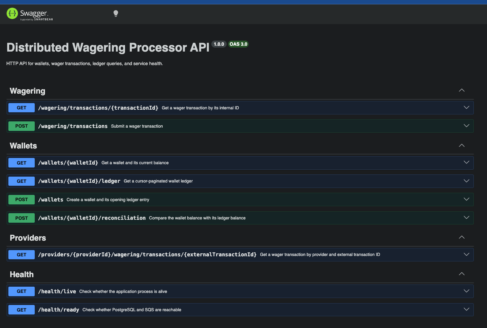
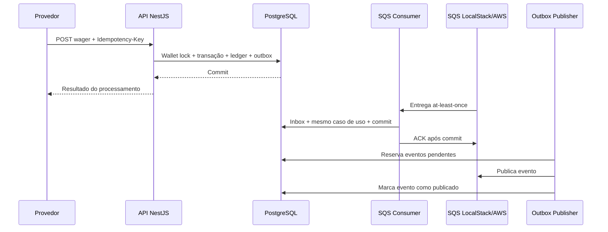

# Distributed Wagering Processor

API financeira para processar operações de apostas com valores exatos, ledger auditável, idempotência persistente e processamento assíncrono com PostgreSQL e SQS.

## Pré-requisitos

- Bun 1.x
- Docker com Docker Compose
- Git

## Iniciar o projeto localmente

1. Clone o repositório e entre na pasta do projeto.
2. Se ainda não tiver um `.env`, crie-o a partir do exemplo:

   ```bash
   test -f .env || cp .env.example .env
   ```

   Preencha `KEYCLOAK_ADMIN_PASSWORD` e `KEYCLOAK_LOAD_CLIENT_SECRET` com valores aleatórios. Para o usuário inicial, configure `AUTH_SEED_EMAIL` e `AUTH_SEED_PASSWORD` (mínimo de 12 caracteres). O `.env` já concentra todas as configurações; os comandos não exigem variáveis inline. Se sua distribuição do LocalStack exigir autenticação, informe seu token em `LOCALSTACK_AUTH_TOKEN`.

3. Instale as dependências:

   ```bash
   bun install
   ```

4. Suba PostgreSQL, LocalStack, inicialização das filas e Keycloak:

   ```bash
   docker compose up -d
   ```

   O serviço `sqs-init` cria as filas FIFO `wager-transactions.fifo`, `wager-transactions-dlq.fifo` e `wager-events.fifo`. Confira os serviços e as filas:

   ```bash
   docker compose ps -a
   docker compose exec localstack awslocal sqs list-queues
   ```

   O endpoint local da API AWS é `http://localhost:4566`. A imagem abaixo registra as filas criadas no LocalStack:

   

5. Aplique as migrations do banco:

   ```bash
   bun run migration:up
   ```

   A migration `Migration20261120000000` remove a antiga tabela `auth_users`; contas da autenticação própria não são migradas. O rollback recria a estrutura, mas não recupera contas apagadas. O cadastro e as senhas passam a pertencer ao Keycloak.

   Aguarde o Keycloak ficar saudável e crie o usuário do `.env`:

   ```bash
   docker compose ps keycloak
   bun run seed:user
   ```

   O seed usa a Admin API do Keycloak, preserva a senha se o e-mail já existir e não inicia a API. A persistência local fica em `.volumes/keycloak`; os arquivos não entram no Git.

6. Inicie a API em modo de desenvolvimento:

   ```bash
   bun run start:dev
   ```

7. Acesse o Swagger em [http://localhost:3000/docs](http://localhost:3000/docs). A especificação OpenAPI fica em [http://localhost:3000/docs-json](http://localhost:3000/docs-json).

   

8. Confira liveness, readiness e métricas:

   ```bash
   curl http://localhost:3000/health/live
   curl http://localhost:3000/health/ready
   curl http://localhost:3000/metrics
   ```

   `/health/ready` verifica PostgreSQL e SQS. `/metrics` exporta métricas no formato Prometheus.

Para encerrar a aplicação, pare o processo iniciado no terminal. Para parar os containers sem apagar os dados persistidos:

```bash
docker compose down
```

## Autenticar e usar a API

1. Abra [Swagger](http://localhost:3000/docs) e clique em **Authorize**.
2. O client é `wagering-swagger`; não informe client secret. Selecione `openid`, `email` e `profile`.
3. Clique em **Authorize** e faça login na tela do Keycloak com o usuário provisionado pelo seed. O link de cadastro dessa tela permite criar outra conta local.
4. O navegador retorna a `/docs/oauth2-redirect.html`; o Swagger troca o código com PKCE e envia o access token nas requisições.
5. Execute `GET /auth/session` para conferir a identidade e depois use as rotas financeiras.

O console administrativo é [Keycloak](http://localhost:8080/admin/), usando `KEYCLOAK_ADMIN_USERNAME` e `KEYCLOAK_ADMIN_PASSWORD`. Escolha o realm `wagering`. As antigas rotas `POST /auth/login` e `POST /auth/register` foram removidas: login/cadastro acontecem no IdP. Health e métricas continuam públicos.

O realm importado inclui o client público `wagering-swagger` (Authorization Code + PKCE) e o client confidencial `wagering-load` (conta de serviço para o benchmark). A API valida RS256, JWKS, `iss`, `aud`, `exp`, `iat`, `sub` e o tipo de access token. Tokens do client de carga incluem a audiência `wagering-api`.

Se mudar porta/origem, ajuste `PORT`, `KEYCLOAK_API_ORIGIN`, `KEYCLOAK_SWAGGER_REDIRECT_URI`, `KEYCLOAK_BASE_URL`, `OIDC_ISSUER` e os clients correspondentes no console. O import de realm é aplicado quando ele ainda não existe; alterar o JSON ou o secret do `.env` não modifica automaticamente clients de um realm persistido. Atualize os clients pelo console, preservando usuários.

## Exemplo rápido de uso da API

Crie uma wallet e use o `id` retornado na próxima requisição:

```bash
curl --request POST http://localhost:3000/wallets \
  --header 'Authorization: Bearer <access-token>' \
  --header 'content-type: application/json' \
  --data '{
    "playerId": "0192f28f-5dc0-7d58-bdb2-814ad6a0f4a1",
    "initialBalance": { "amount": "1000.00", "currency": "BRL" }
  }'
```

Envie uma aposta usando o `walletId` retornado:

```bash
curl --request POST http://localhost:3000/wagering/transactions \
  --header 'Authorization: Bearer <access-token>' \
  --header 'content-type: application/json' \
  --header 'Idempotency-Key: provider-a:transaction-123' \
  --header 'X-Correlation-Id: local-request-123' \
  --data '{
    "providerId": "provider-a",
    "externalTransactionId": "transaction-123",
    "playerId": "0192f28f-5dc0-7d58-bdb2-814ad6a0f4a1",
    "walletId": "<wallet-id-retornado>",
    "roundId": "round-987",
    "gameId": "fortune-chimp",
    "kind": "BET",
    "money": { "amount": "25.00", "currency": "BRL" }
  }'
```

## Rotas HTTP

| Método | Rota | Uso |
|---|---|---|
| `GET` | `/auth/session` | Valida o bearer token e retorna o sujeito autenticado. |
| `POST` | `/wallets` | Cria wallet; saldo inicial positivo gera transação `OPENING` e crédito no ledger. |
| `GET` | `/wallets/:walletId` | Consulta saldo e versão da wallet. |
| `GET` | `/wallets/:walletId/ledger` | Consulta ledger com cursor estável. |
| `POST` | `/wallets/:walletId/reconciliation` | Compara o saldo materializado com o saldo reconstruído pelo ledger. |
| `POST` | `/wagering/transactions` | Processa BET, WIN, LOSS, REFUND ou ROLLBACK; requer `Idempotency-Key`. |
| `GET` | `/wagering/transactions/:transactionId` | Consulta por ID interno. |
| `GET` | `/providers/:providerId/wagering/transactions/:externalTransactionId` | Consulta pelos IDs do provedor. |
| `GET` | `/health/live` | Verifica se o processo está ativo. |
| `GET` | `/health/ready` | Verifica conectividade com PostgreSQL e SQS. |
| `GET` | `/metrics` | Exporta métricas Prometheus. |

## Como o processamento funciona

1. A API valida o contrato e calcula SHA-256 sobre o JSON canônico dos campos de negócio.
2. O caso de uso abre uma transação SQL, bloqueia a wallet e verifica a chave de idempotência.
3. A transação, o saldo, o ledger e os eventos da outbox são persistidos juntos.
4. O consumidor SQS registra a mensagem na inbox e confirma o ACK somente depois do commit.
5. Workers publicam a outbox e reprocessam referências pendentes; redeliveries são protegidos pela inbox e pela idempotência no banco.



## Estrutura do projeto

```text
src/
├── modules/wagering/
│   ├── application/       # Casos de uso e hash canônico da operação
│   ├── domain/            # Entidades, regras, eventos e portas
│   ├── infrastructure/    # MikroORM, PostgreSQL, SQS, inbox/outbox e workers
│   └── presentation/http/ # Controllers, health e métricas
├── modules/authentication/
│   ├── application/       # Porta de verificação de access token
│   ├── infrastructure/    # Configuração OIDC e validação JWT/JWKS
│   └── presentation/http/ # Consulta da identidade autenticada
├── shared/
│   ├── domain/            # Money e tipos compartilhados
│   └── infrastructure/    # Guard JWT, logger e métricas
└── main.ts                # Bootstrap, logger JSON e Swagger
scripts/localstack/        # Criação das filas locais
scripts/keycloak/          # Realm, clients, audiência e PKCE
scripts/seed-user.ts        # Usuário inicial via Admin API do IdP
test/
├── fixtures/              # Processo auxiliar para cenário multi-instância
├── integration/           # PostgreSQL e LocalStack reais
└── wagering-routes.e2e.test.ts
```

## Testes e o que cobrem

| Comando | Cobertura principal |
|---|---|
| `bun run test` | Money, validações, invariantes de Wallet, transições de WagerTransaction e formatação das métricas. |
| `bun run test:e2e` | Rotas HTTP, contratos e status 200/202/400/404/409/422, health checks, métricas e Swagger. |
| `bun run test:integration` | PostgreSQL, LocalStack e Keycloak reais: seed idempotente e login PKCE, migrations e constraints, atomicidade, inbox/outbox, retries, DLQ, redelivery, reinício e reconciliação. Inclui 50 entregas simultâneas, disputa por saldo, wallets diferentes e três processos Bun independentes, SIGKILL após commit antes de ACK e recuperação em novo processo. |
| `bun run test:load` | Benchmark HTTP contra uma instância local, com métricas de desempenho e reconciliação final; gera relatório JSON em `reports/load-tests/`. |
| `bun run test:all` | Executa unidade/Swagger, e2e e integração em sequência com o runner nativo do Bun. |
| `bun run seed:user` | Provisiona a conta inicial no Keycloak a partir do `.env`; não altera contas existentes. |
| `bun run build` | Compilação TypeScript/NestJS. |
| `bun run lint` | Regras estáticas em `src/` e `test/`. |

Os testes de integração criam um schema exclusivo em cada execução e imprimem seu nome. `KEEP_TEST_SCHEMA=true` mantém o schema e seus dados para auditoria; `false` remove o schema ao terminar.

O teste de carga exige `LOAD_TEST_CONFIRM_LOCAL=YES` e só aceita PostgreSQL e SQS em hosts locais. Use `DB_POSTGRES_HOST=localhost` se seu `.env` usar `0.0.0.0` para bind local. Cria um schema e filas temporários exclusivos, inicia sua própria instância HTTP e remove as filas e o processo ao terminar. O schema segue `KEEP_TEST_SCHEMA`. Configure `LOAD_TEST_REQUESTS`, `LOAD_TEST_CONCURRENCY` e `LOAD_TEST_WARMUP_REQUESTS`; o relatório registra ambiente, método, throughput, p50/p95/p99, taxa de erro, conflitos de lock observados pela métrica e atraso amostrado da outbox. Como o desafio não define meta de RPS, os resultados são uma baseline deste ambiente local.

Baseline BET com autenticação Keycloak registrada: 500 operações medidas, concorrência 25, 485,1 req/s, p50 47,2 ms, p95 78,9 ms, p99 94,2 ms, 0% de erros e delta de conflitos PostgreSQL igual a zero. Saldo final de 994,90 BRL e 511 lançamentos conferidos pela reconciliação (inclui 10 apostas de aquecimento). A outbox chegou a 0,856 s durante a amostragem e estava em 1,043 s após a carga. Este experimento curto não estabelece capacidade sustentada de produção: [relatório BET](reports/load-tests/load-2026-11-16T23-22-37.441Z.json).

## Logs e métricas

- Os logs da aplicação são JSON e carregam IDs de correlação e domínio quando disponíveis: `correlationId`, `messageId`, `transactionId`, `walletId` e `providerId`.
- Saldos, valores monetários e corpos completos de mensagens não são registrados nos logs da aplicação.
- `/metrics` exporta contadores de transações por status, entregas duplicadas, retries, divergências de reconciliação e conflitos PostgreSQL relacionados a locks, erros de coleta, histograma de duração, atraso da outbox e quantidade aproximada de mensagens visíveis na DLQ.
- Contadores e histograma são locais ao processo; o scraper deve coletar cada instância para agregá-los. A quantidade da DLQ é aproximada pelo atributo do SQS.

## Autenticação

A autenticação é delegada ao Keycloak, conforme a orientação do desafio. A API é um resource server e não armazena senhas. O guard global verifica access tokens pelas chaves públicas do IdP; health e métricas usam `@Public()`. Identidade válida ainda não representa autorização por proprietário: todos os tokens aceitos para esta audiência podem usar as rotas de negócio. Políticas por tenant, jogador/provedor e wallet permanecem uma evolução fora deste fluxo de demonstração. O Keycloak usa `start-dev` e persistência local de desenvolvimento, não uma configuração de produção.

## Configurações e diagnóstico

| Variáveis | Uso |
|---|---|
| `DB_POSTGRES_HOST`, `DB_POSTGRES_PORT`, `DB_POSTGRES_NAME`, `DB_POSTGRES_USER`, `DB_POSTGRES_PASSWORD` | Conexão da aplicação ao banco |
| `DB_POSTGRES_BIND_HOST` | Endereço IP para publicar a porta Docker; use IP, não nome DNS |
| `DB_POSTGRES_SCHEMA` | Schema opcional da aplicação; testes usam schemas próprios |
| `KEYCLOAK_ADMIN_USERNAME`, `KEYCLOAK_ADMIN_PASSWORD` | Bootstrap e autenticação administrativa do seed |
| `AUTH_SEED_EMAIL`, `AUTH_SEED_PASSWORD` | Conta humana a provisionar no IdP |
| `OIDC_ISSUER`, `OIDC_AUDIENCE`, `OIDC_SWAGGER_CLIENT_ID` | Confiança e client do Swagger |
| `KEYCLOAK_BASE_URL`, `KEYCLOAK_PORT` | Acesso local ao IdP e publicação da porta Docker |
| `KEYCLOAK_SWAGGER_REDIRECT_URI`, `KEYCLOAK_API_ORIGIN` | Redirect exato e origem permitida do client público |
| `KEYCLOAK_LOAD_CLIENT_SECRET` | Secret do client de serviço do benchmark |
| `LOAD_TEST_CONFIRM_LOCAL`, `LOAD_TEST_REQUESTS`, `LOAD_TEST_CONCURRENCY`, `LOAD_TEST_WARMUP_REQUESTS`, `LOAD_TEST_REPORT_PATH` | Habilitação, dimensão e saída do benchmark |
| `KEEP_TEST_SCHEMA` | Preserva dados de testes para auditoria quando true |
| `AWS_SQS_ENDPOINT`, `AWS_SQS_QUEUE_URL`, `AWS_SQS_EVENTS_QUEUE_URL`, `AWS_SQS_DLQ_QUEUE_URL` | LocalStack e filas de entrada, eventos e falhas |

- Seed com erro 401: confira admin e senha do primeiro bootstrap; editar `.env` não redefine um administrador existente.
- Carga com erro no token: confira se o Keycloak está saudável e se o secret do client `wagering-load` coincide com o `.env`.
- API com 401: confira emissor exato (`localhost` e `127.0.0.1` são emissores diferentes), audiência e token de acesso, não ID token.
- Docker com endereço inválido: use `DB_POSTGRES_BIND_HOST` para bind e `DB_POSTGRES_HOST` para conexão; `localhost` serve para conexão da aplicação executada no host.
- As imagens dos assets são registros da interface; testes reais e relatórios são a evidência automatizada.

As decisões de locking, idempotência, retries, outbox, reversões e autenticação estão em [ARCHITECTURE.md](ARCHITECTURE.md).
